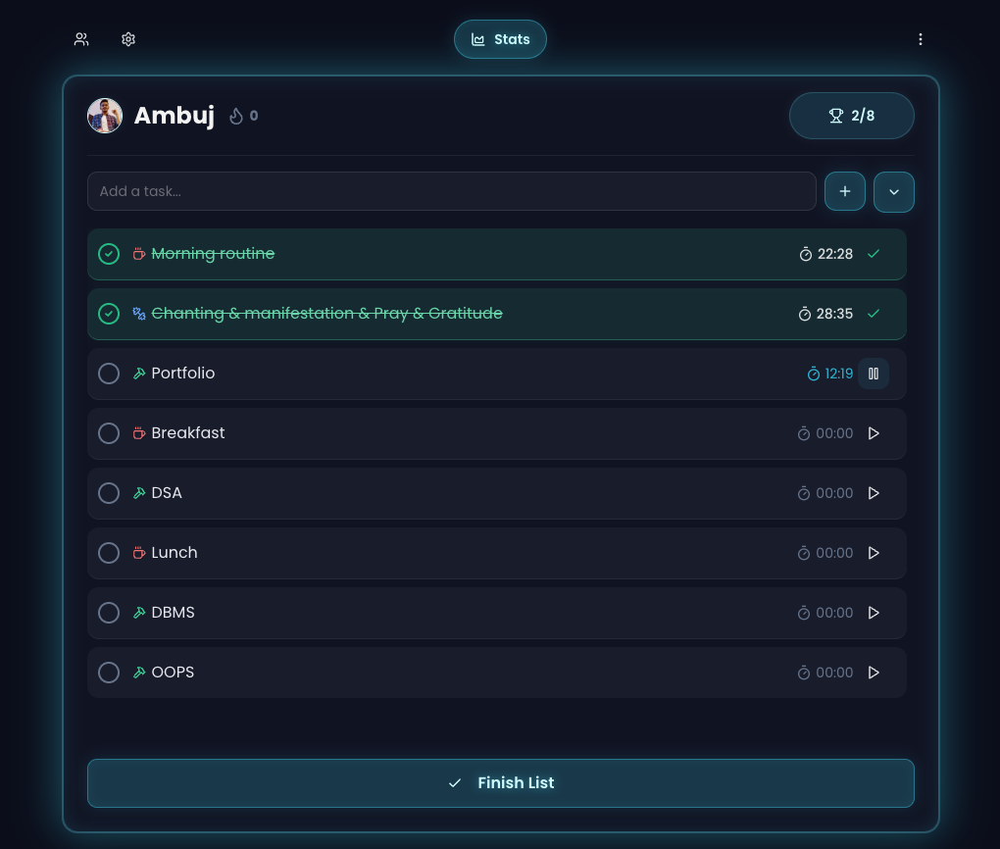
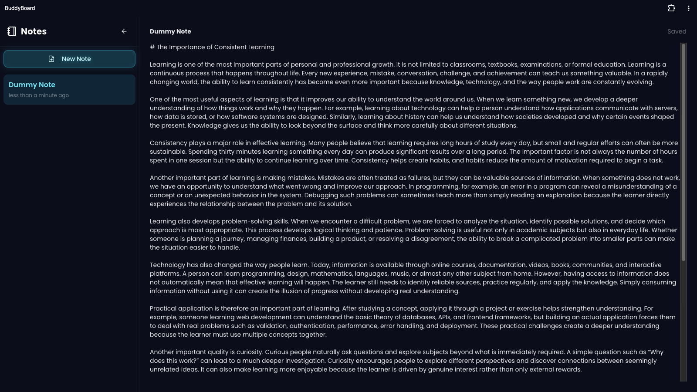
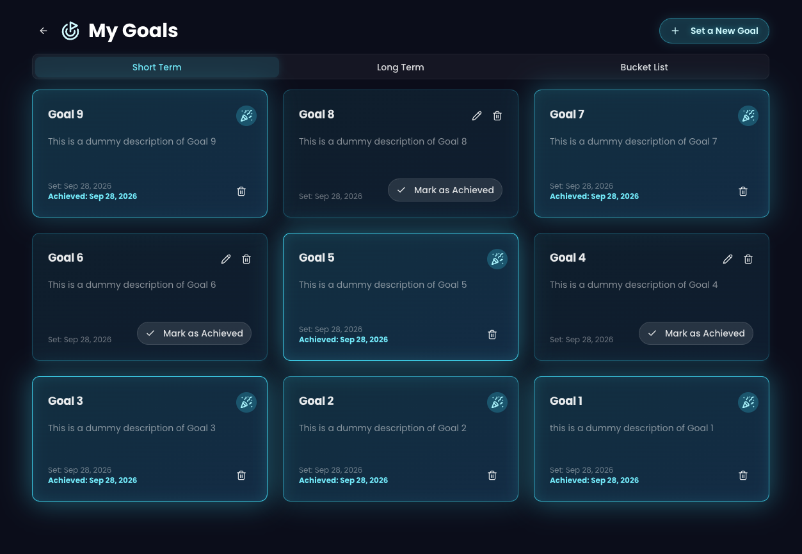
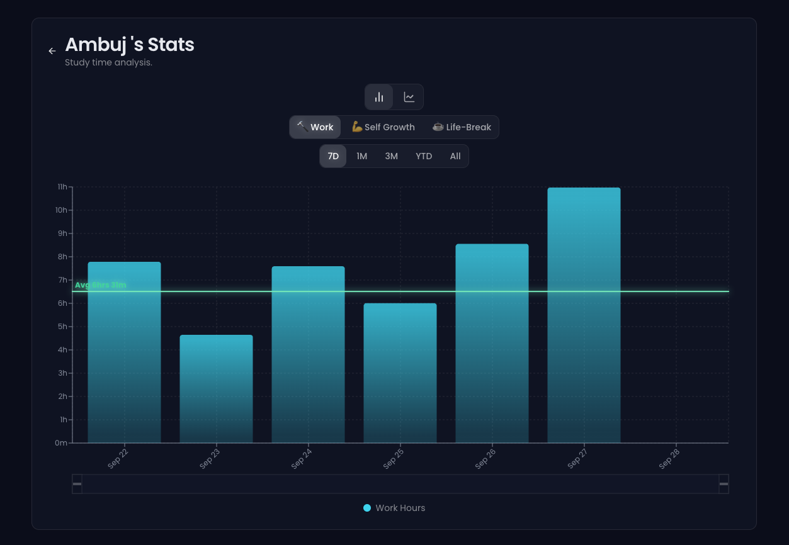
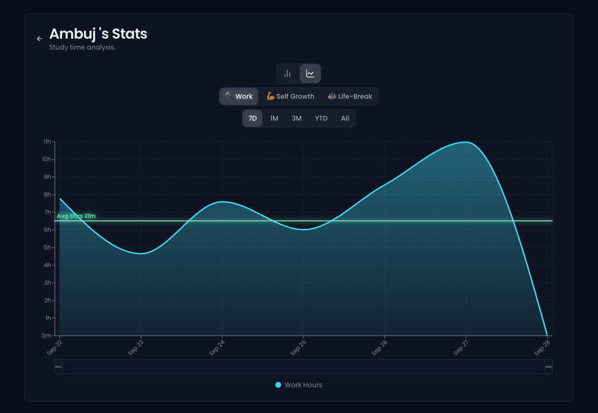

<div align="center">

# BuddyBoard

**A real-time accountability board for pairs and study groups.**
Lock in your day, track time per task, and watch your buddy's progress update live.


</div>



<table>
  <tr>
    <td></td>
    <td></td>
  </tr>
  <tr>
    <td></td>
    <td></td>
  </tr>
</table>

## Why BuddyBoard?

Solo to-do apps are easy to abandon because nobody notices when you skip a task. Video-call "study with me" sessions fix that but drain battery and attention. BuddyBoard sits in between: you see your buddy's task list and live timers on screen, with no camera or audio needed.

## Features

### Accountability
- **Pairing and groups.** Pair 1-on-1 through in-app invitations, or create a group and invite members by code or email. Groups have admin, co-admin and member roles.
- **Lock In.** Lock your list for the day so tasks can't be quietly dropped. Finishing a list with every task done grows your streak.
- **Live sync.** Your buddy's tasks and timers update in real time through Firestore `onSnapshot` listeners.
- **Streaks and score.** Streak badge plus a completed/assigned score on every card.
- **Celebration overlay** when you finish a fully completed list.

### Task management
- **Categorized tasks:** Deep Work, Self-Growth and Life Break.
- **Per-task timers.** Timers store `timeSpent` plus a `timerStartedAt` epoch timestamp, so elapsed time stays correct through background-tab throttling and reloads.
- **Drag-and-drop reordering** with `@hello-pangea/dnd`, inline editing, manual time correction, and a previous-lists history you can restore from.

### Insights
- **Stats page** with Recharts bar and area views per category, 7D / 1M / 3M / YTD / All ranges, an average reference line and a **brush** for custom time filtering.

### Productivity extras
- **Notes** with auto-save (1.5s debounce).
- **Goals** split into Short Term, Long Term and Bucket List, with mark-as-achieved.
- **Themes.** Light and dark mode plus per-user accent colors (periwinkle, cyan, emerald).
- **Offline cache.** Firestore persistent multi-tab cache.

## Tech Stack

| Area | Tech |
|---|---|
| Framework | Next.js 15 (App Router, Turbopack), React 18, TypeScript |
| Styling / UI | Tailwind CSS, Radix UI primitives, Framer Motion, Lucide icons |
| Backend | Firebase Authentication (email/password), Cloud Firestore |
| Charts | Recharts |
| Drag and drop | `@hello-pangea/dnd` |
| Forms / validation | React Hook Form, Zod |
| Hosting | Firebase App Hosting |

## Architecture

```
/users/{uid}                         profile, theme, pairedWith, groupId
/task_lists/{uid}                    tasks, lock/finish state, streaks, historical_stats
/groups/{groupId}                    name, invitationCode, members{uid: role}
/pair_invitations/{id}               sender, receiver, status
/group_invitations/{id}              group, receiverEmail, status
/user_notes/{uid}/notes/{noteId}     notes
/user_goals/{uid}/goals/{goalId}     goals
```

- Each user's board is one `task_lists/{uid}` document. A paired user or group-mate subscribes to it with `onSnapshot`.
- [`firestore.rules`](firestore.rules) restricts task-list writes to the owner. Reads are allowed for the owner, the paired partner, or users in the same group. Group and invitation rules enforce roles.
- Multi-document changes (onboarding, pairing, joining or leaving a group) use `writeBatch` and `runTransaction`.

## Getting Started

### Prerequisites
- Node.js 18+
- A Firebase project with **Authentication (Email/Password)** and **Firestore** enabled

### Setup

```bash
git clone https://github.com/iambuzzz/RiyalTodo.git
cd RiyalTodo
npm install
```

Create `.env.local` in the project root:

```bash
NEXT_PUBLIC_FIREBASE_API_KEY=...
NEXT_PUBLIC_FIREBASE_AUTH_DOMAIN=...
NEXT_PUBLIC_FIREBASE_PROJECT_ID=...
NEXT_PUBLIC_FIREBASE_STORAGE_BUCKET=...
NEXT_PUBLIC_FIREBASE_MESSAGING_SENDER_ID=...
NEXT_PUBLIC_FIREBASE_APP_ID=...
```

Deploy the security rules to your Firebase project:

```bash
firebase deploy --only firestore:rules
```

Start the dev server:

```bash
npm run dev
```

Open [http://localhost:9002](http://localhost:9002).

### Scripts

| Command | Description |
|---|---|
| `npm run dev` | Dev server on port 9002 (Turbopack) |
| `npm run build` | Production build |
| `npm start` | Run the production build |
| `npm run lint` | Lint |
| `npm run typecheck` | TypeScript check |

## Project Structure

```
src/
  app/          Pages: dashboard, login, stats/[userId], notes, goals, settings
  components/   Task card/list/item, stats charts, notes, goals, overlays, UI primitives
  firebase/     Firebase init, auth hook, providers, error handling
  lib/          Shared types and utilities
docs/           Blueprint, data model, screenshots
firestore.rules Firestore security rules
```

## Known Limitations

- A user's tasks live in one array inside a single document, so concurrent edits from two devices are last-write-wins. Moving tasks to a subcollection is the natural next step.
- Streak and totals are computed client-side. A Cloud Function or transaction would make them tamper-proof.
- Some Firestore rules (user pairing writes, co-admin kick checks) trust client-supplied fields and could be tightened.

## Roadmap

- Single-focus mode (pause other timers when one starts)
- Weekly partner summaries
- AI task breakdown (Genkit and Gemini are already wired up in `src/ai`)

## Author

Built by [@iambuzzz](https://github.com/iambuzzz).
